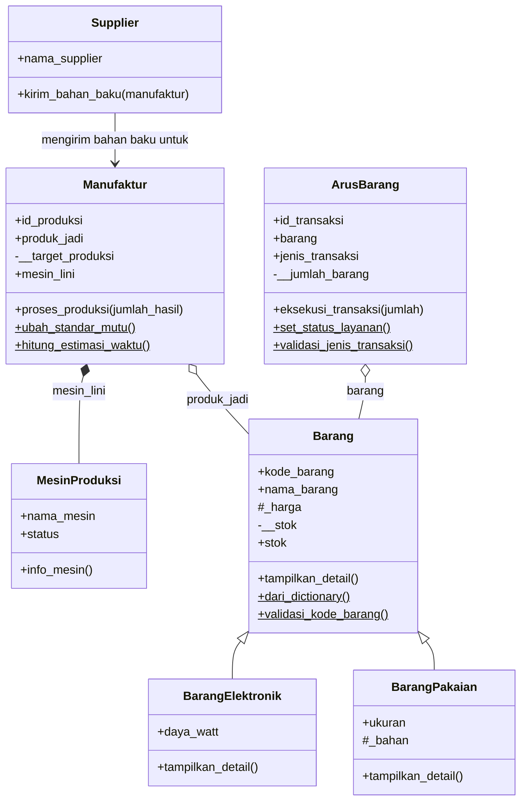
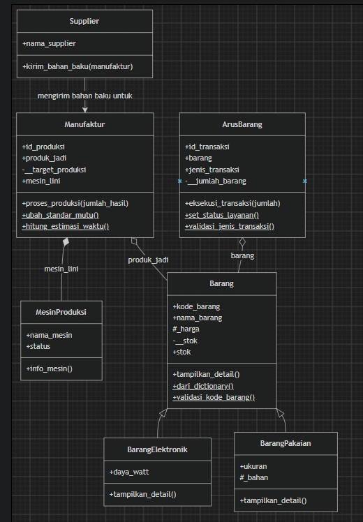
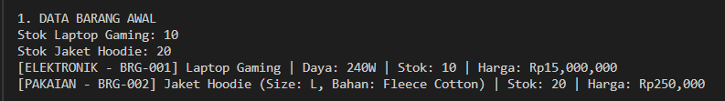
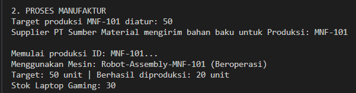
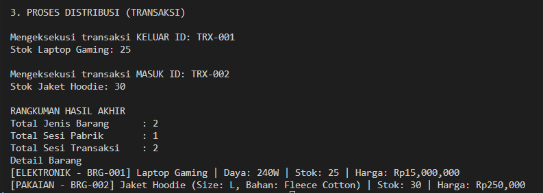

# Laporan Posttest – Relasi UML & Inheritance
## Sistem SIGMA Logistics, Manufacturing & Distribution

## 1. Deskripsi Program

Program ini mensimulasikan alur kerja perusahaan **SIGMA** yang mencakup tiga proses utama:

1. **Pengelolaan barang** (`Barang`, `BarangElektronik`, `BarangPakaian`)
2. **Proses manufaktur** (`Manufaktur`, `MesinProduksi`, `Supplier`)
3. **Distribusi / arus barang** (`ArusBarang`)

Stok barang bertambah ketika terjadi produksi atau transaksi **MASUK**, dan berkurang ketika terjadi transaksi **KELUAR**.

### Daftar Class

| Class | Peran |
|---|---|
| `Supplier` | Pemasok bahan baku untuk proses manufaktur |
| `MesinProduksi` | Mesin yang digunakan pada lini produksi |
| `Barang` | **Superclass** dari semua jenis barang |
| `BarangElektronik` | **Subclass** dari `Barang` (atribut khusus: `daya_watt`) |
| `BarangPakaian` | **Subclass** dari `Barang` (atribut khusus: `ukuran`, `_bahan`) |
| `Manufaktur` | Mengelola proses produksi barang jadi |
| `ArusBarang` | Mengelola transaksi barang masuk dan keluar |

---

## 2. Diagram UML



> 

---

## 3. Penerapan Relasi UML

### 3.1 Asosiasi (Association)

**Relasi:** `Supplier` → `Manufaktur`

Asosiasi adalah hubungan di mana satu class **menggunakan** class lain tanpa saling memiliki. Pada program ini, `Supplier` tidak menyimpan `Manufaktur` sebagai atribut. Objek `Manufaktur` hanya diterima sebagai **parameter method** saat `Supplier` mengirim bahan baku.

```python
class Supplier:
    def __init__(self, nama_supplier):
        self.nama_supplier = nama_supplier

    def kirim_bahan_baku(self, manufaktur):
        print(f"Supplier {self.nama_supplier} mengirim bahan baku untuk Produksi: {manufaktur.id_produksi}")
```

Pemanggilan pada `main`:

```python
manufaktur1 = Manufaktur("MNF-101", barang_elektronik, 50)
supplier1 = Supplier("PT Sumber Material")
supplier1.kirim_bahan_baku(manufaktur1)
```

**Penjelasan:** `Supplier` dan `Manufaktur` hidup sendiri-sendiri. Keduanya hanya berhubungan sesaat ketika method `kirim_bahan_baku()` dipanggil.

---

### 3.2 Agregasi (Aggregation)

**Relasi:** `Manufaktur` ◇— `Barang` dan `ArusBarang` ◇— `Barang`

Agregasi adalah hubungan "memiliki" yang **lemah** (*has-a*). Objek bagian dibuat **di luar** class pemilik, lalu dimasukkan lewat constructor. Jika pemilik dihapus, objek bagian **tetap ada**.

```python
class Manufaktur:
    def __init__(self, id_produksi, produk_jadi, target_produksi):
        self.id_produksi = id_produksi
        self.produk_jadi = produk_jadi   # objek Barang diterima dari luar
        ...

class ArusBarang:
    def __init__(self, id_transaksi, barang, jenis_transaksi):
        self.id_transaksi = id_transaksi
        self.barang = barang             # objek Barang diterima dari luar
        ...
```

Objek `barang_elektronik` dibuat terlebih dahulu, kemudian dipakai bersama oleh `Manufaktur` dan `ArusBarang`:

```python
barang_elektronik = BarangElektronik("BRG-001", "Laptop Gaming", 10, 15000000, 240)
manufaktur1 = Manufaktur("MNF-101", barang_elektronik, 50)
transaksi1  = ArusBarang("TRX-001", barang_elektronik, "KELUAR")
```

**Penjelasan:** `barang_elektronik` berdiri sendiri dan dipakai oleh dua class berbeda. Karena itu stok laptop berubah akibat produksi (+20) dan juga akibat transaksi keluar (−5).

---

### 3.3 Komposisi (Composition)

**Relasi:** `Manufaktur` ◆— `MesinProduksi`

Komposisi adalah hubungan "memiliki" yang **kuat**. Objek bagian dibuat **di dalam** class pemilik, sehingga siklus hidupnya bergantung pada pemilik. Jika pemilik dihapus, objek bagian ikut hilang.

```python
class Manufaktur:
    def __init__(self, id_produksi, produk_jadi, target_produksi):
        ...
        self.mesin_lini = MesinProduksi(f"Robot-Assembly-{self.id_produksi}")
```

**Penjelasan:** Objek `MesinProduksi` dibuat langsung di dalam constructor `Manufaktur`, tanpa dikirim dari luar. Setiap proses manufaktur memiliki mesinnya sendiri (misalnya `Robot-Assembly-MNF-101`). Mesin ini tidak bisa berdiri sendiri di luar `Manufaktur`.

### Ringkasan Relasi UML

| Relasi | Class | Bukti di Kode |
|---|---|---|
| **Asosiasi** | `Supplier` → `Manufaktur` | `manufaktur` hanya sebagai parameter `kirim_bahan_baku()` |
| **Agregasi** | `Manufaktur` ◇— `Barang` | `produk_jadi` dikirim dari luar lewat constructor |
| **Agregasi** | `ArusBarang` ◇— `Barang` | `barang` dikirim dari luar lewat constructor |
| **Komposisi** | `Manufaktur` ◆— `MesinProduksi` | `MesinProduksi(...)` dibuat di dalam constructor `Manufaktur` |

---

## 4. Penerapan Inheritance

### 4.1 Superclass dan Subclass

| Peran | Class |
|---|---|
| **Superclass** (Parent) | `Barang` |
| **Subclass** (Child) 1 | `BarangElektronik` |
| **Subclass** (Child) 2 | `BarangPakaian` |

```python
class Barang:
    ...

class BarangElektronik(Barang):
    ...

class BarangPakaian(Barang):
    ...
```

---

### 4.2 Penggunaan `super().__init__()`

Kedua subclass memanggil constructor `Barang` agar atribut milik parent (`kode_barang`, `nama_barang`, `stok`, `_harga`) ikut diinisialisasi.

```python
class BarangElektronik(Barang):
    def __init__(self, kode_barang, nama_barang, stok_awal, harga, daya_watt):
        super().__init__(kode_barang, nama_barang, stok_awal, harga)
        self.daya_watt = daya_watt

class BarangPakaian(Barang):
    def __init__(self, kode_barang, nama_barang, stok_awal, harga, ukuran, bahan):
        super().__init__(kode_barang, nama_barang, stok_awal, harga)
        self.ukuran = ukuran
        self._bahan = bahan
```

---

### 4.3 Atribut Tambahan (Spesifik Subclass)

| Class | Atribut Unik | Keterangan |
|---|---|---|
| `Barang` | – | Atribut umum: `kode_barang`, `nama_barang`, `_harga`, `__stok` |
| `BarangElektronik` | `daya_watt` | Daya listrik barang (Watt) |
| `BarangPakaian` | `ukuran`, `_bahan` | Ukuran dan bahan pakaian |

Atribut-atribut tersebut tidak dimiliki oleh parent maupun subclass lainnya.

---

### 4.4 Method Overriding

Method `tampilkan_detail()` milik `Barang` didefinisikan ulang di kedua subclass dengan format dan informasi yang berbeda.

**Parent (`Barang`):**
```python
def tampilkan_detail(self):
    print(f"[{self.kode_barang}] {self.nama_barang} | Stok: {self.stok} unit | Harga: Rp{self._harga:,}")
```

**Override di `BarangElektronik`:** menambahkan label `ELEKTRONIK` dan informasi daya.
```python
def tampilkan_detail(self):
    print(f"[ELEKTRONIK - {self.kode_barang}] {self.nama_barang} | Daya: {self.daya_watt}W | Stok: {self.stok} | Harga: Rp{self._harga:,}")
```

**Override di `BarangPakaian`:** menambahkan label `PAKAIAN` serta informasi ukuran dan bahan.
```python
def tampilkan_detail(self):
    print(f"[PAKAIAN - {self.kode_barang}] {self.nama_barang} (Size: {self.ukuran}, Bahan: {self._bahan}) | Stok: {self.stok} | Harga: Rp{self._harga:,}")
```

**Penjelasan:** Saat `tampilkan_detail()` dipanggil, Python menjalankan versi method sesuai tipe objeknya (polimorfisme).

---

### 4.5 Tingkat Akses (Protected & Private)

| Atribut | Tingkat Akses | Class | Alasan |
|---|---|---|---|
| `_harga` | **Protected** | `Barang` | Perlu diakses langsung oleh subclass saat menampilkan detail |
| `_bahan` | **Protected** | `BarangPakaian` | Data internal pakaian yang boleh dipakai turunannya |
| `__stok` | **Private** | `Barang` | Data sensitif; hanya boleh diubah lewat property `stok` yang memvalidasi input |

**Protected (`_harga`)** diakses langsung di subclass:
```python
# di BarangElektronik
print(f"... | Harga: Rp{self._harga:,}")
```

**Private (`__stok`)** hanya dapat diubah lewat getter dan setter dengan validasi:
```python
@property
def stok(self):
    return self.__stok

@stok.setter
def stok(self, nilai_baru):
    if not isinstance(nilai_baru, int) or nilai_baru < 0:
        print(f"Stok {self.nama_barang} gagal diubah. Input harus angka positif. (Input: {nilai_baru})")
    else:
        self.__stok = nilai_baru
        print(f"Stok {self.nama_barang}: {self.__stok}")
```

Subclass dan class lain (`Manufaktur`, `ArusBarang`) mengubah stok melalui property, bukan langsung ke `__stok`:
```python
self.produk_jadi.stok += jumlah_hasil   # di Manufaktur
self.barang.stok -= self.jumlah_barang  # di ArusBarang
```

---

## 5. Konsep Pendukung

| Konsep | Penerapan |
|---|---|
| **Encapsulation** | `__stok`, `__target_produksi`, `__jumlah_barang` dengan `@property` dan setter validasi |
| **Class variable** | `total_jenis_barang`, `total_proses_manufaktur`, `total_transaksi`, `standar_mutu`, `status_layanan` |
| **Class method** | `Barang.dari_dictionary()`, `Manufaktur.ubah_standar_mutu()`, `ArusBarang.set_status_layanan()` |
| **Static method** | `Barang.validasi_kode_barang()`, `Manufaktur.hitung_estimasi_waktu()`, `ArusBarang.validasi_jenis_transaksi()` |

---

## 6. Hasil Eksekusi Program

Alur pada `main`:

1. Membuat 2 barang: Laptop Gaming (stok 10) dan Jaket Hoodie (stok 20).
2. Supplier mengirim bahan baku, lalu `Manufaktur` memproduksi 20 laptop, sehingga stok laptop menjadi **30**.
3. Transaksi `KELUAR` 5 laptop, sehingga stok menjadi **25**.
4. Transaksi `MASUK` 10 jaket, sehingga stok menjadi **30**.

### Output

```text
SIGMA Logistics Center

1. DATA BARANG AWAL
Stok Laptop Gaming: 10
Stok Jaket Hoodie: 20
[ELEKTRONIK - BRG-001] Laptop Gaming | Daya: 240W | Stok: 10 | Harga: Rp15,000,000
[PAKAIAN - BRG-002] Jaket Hoodie (Size: L, Bahan: Fleece Cotton) | Stok: 20 | Harga: Rp250,000

2. PROSES MANUFAKTUR
Target produksi MNF-101 diatur: 50
Supplier PT Sumber Material mengirim bahan baku untuk Produksi: MNF-101

Memulai produksi ID: MNF-101...
Menggunakan Mesin: Robot-Assembly-MNF-101 (Beroperasi)
Target: 50 unit | Berhasil diproduksi: 20 unit
Stok Laptop Gaming: 30

3. PROSES DISTRIBUSI (TRANSAKSI)

Mengeksekusi transaksi KELUAR ID: TRX-001
Stok Laptop Gaming: 25

Mengeksekusi transaksi MASUK ID: TRX-002
Stok Jaket Hoodie: 30

RANGKUMAN HASIL AKHIR
Total Jenis Barang      : 2
Total Sesi Pabrik       : 1
Total Sesi Transaksi    : 2
Detail Barang
[ELEKTRONIK - BRG-001] Laptop Gaming | Daya: 240W | Stok: 25 | Harga: Rp15,000,000
[PAKAIAN - BRG-002] Jaket Hoodie (Size: L, Bahan: Fleece Cotton) | Stok: 30 | Harga: Rp250,000
```

> **1. DATA BARANG AWAL**.
>
> 

> **2. PROSES MANUFAKTUR** (terlihat supplier, mesin, dan stok bertambah).
>
> 

> **3. PROSES DISTRIBUSI** dan **RANGKUMAN HASIL AKHIR**.
>
> 

---

## 7. Kesimpulan

1. Program menerapkan tiga relasi UML: **Asosiasi** (`Supplier` → `Manufaktur`), **Agregasi** (`Manufaktur` dan `ArusBarang` terhadap `Barang`), dan **Komposisi** (`Manufaktur` terhadap `MesinProduksi`).
2. Program menerapkan **inheritance** dengan 1 superclass (`Barang`) dan 2 subclass (`BarangElektronik`, `BarangPakaian`), lengkap dengan `super().__init__()`, atribut unik, dan overriding `tampilkan_detail()`.
3. Pembagian akses **protected** (`_harga`, `_bahan`) dan **private** (`__stok`) menjaga data tetap aman sekaligus tetap bisa dipakai oleh subclass sesuai kebutuhan.

---

## 8. Struktur Repository

```text
.
├── README.md
├── posttest.py
└── assets/
    ├── 01-uml.png
    ├── 02-output-1.png
    ├── 03-output-2.png
    └── 04-output-3.png
```