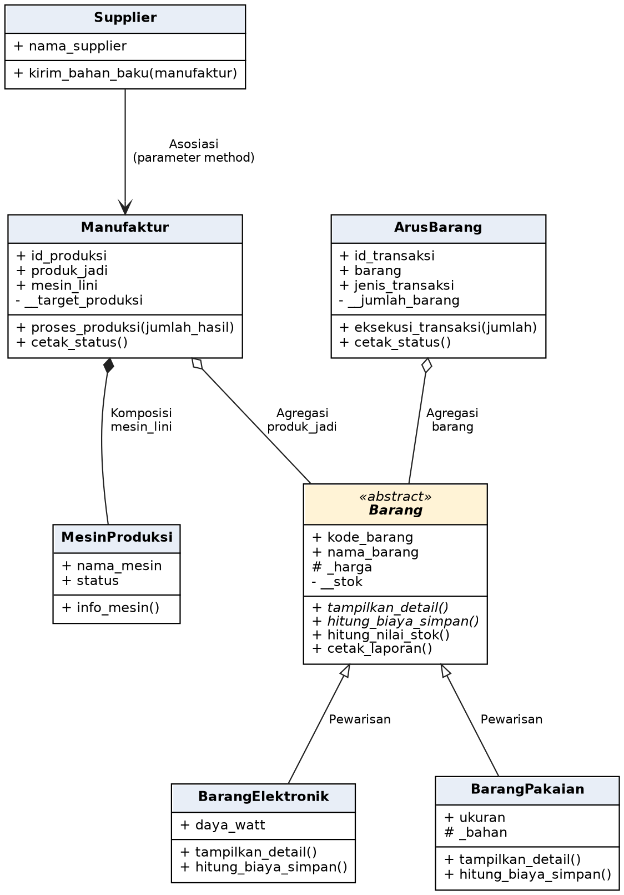
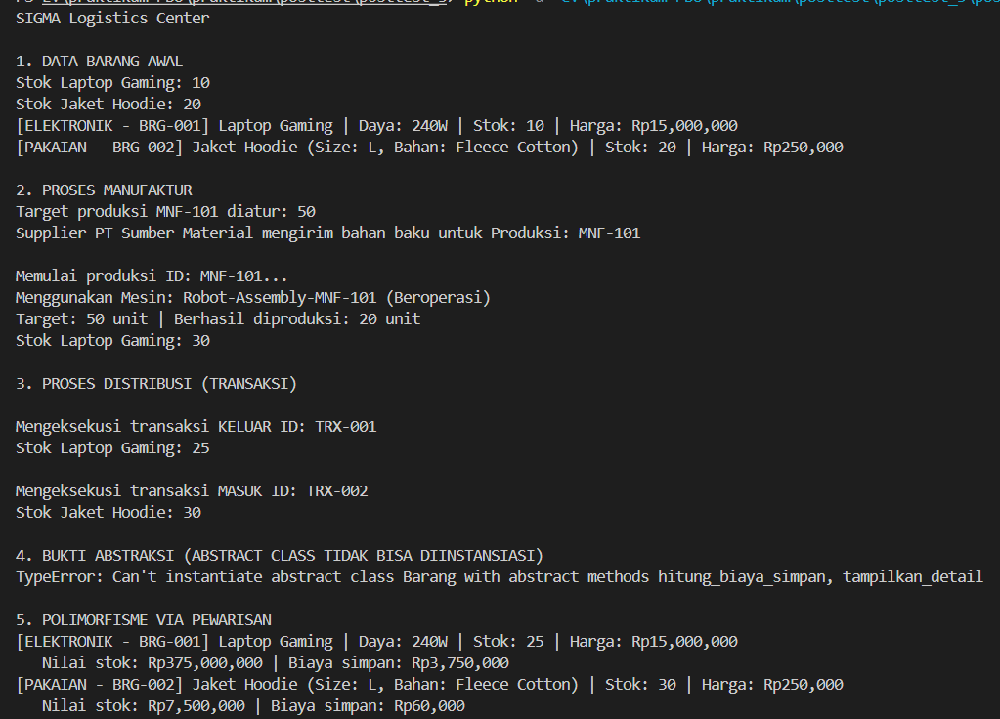
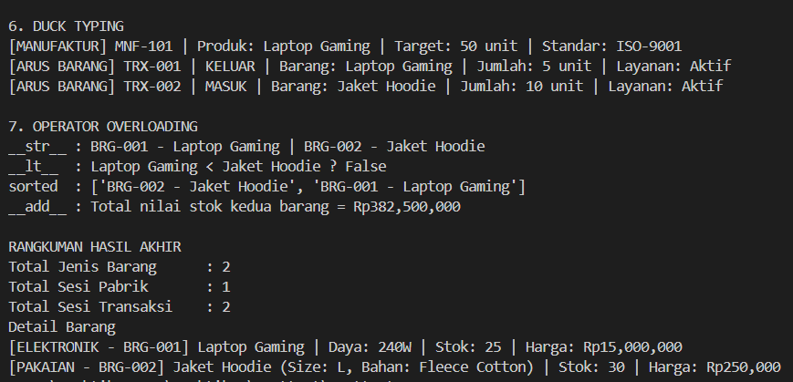

# Posttest Pemrograman Berorientasi Objek — SIGMA Logistics & Manufacturing System

## 1. Deskripsi Program

**SIGMA Logistics & Manufacturing System** adalah program Python berbasis *Object-Oriented Programming* (OOP) untuk menyimulasikan pengelolaan barang di lingkungan logistik dan manufaktur. Program mencakup data barang elektronik dan pakaian, proses produksi, pengiriman bahan baku oleh supplier, serta transaksi barang masuk dan keluar gudang.

Pada posttest ini, program menerapkan relasi UML, abstraksi menggunakan `ABC`, inheritance, polimorfisme melalui overriding, duck typing, dan operator overloading.

## 2. Daftar Kelas

| Kelas | Peran |
|---|---|
| `Supplier` | Mengirim bahan baku untuk proses manufaktur. |
| `MesinProduksi` | Merepresentasikan mesin yang digunakan dalam proses produksi. |
| `Barang` | Abstract base class yang mendefinisikan perilaku umum barang. |
| `BarangElektronik` | Subclass `Barang` untuk barang elektronik; memiliki atribut `daya_watt`. |
| `BarangPakaian` | Subclass `Barang` untuk barang pakaian; memiliki atribut `ukuran` dan `_bahan`. |
| `Manufaktur` | Mengelola proses produksi dan menyimpan referensi barang jadi serta mesin produksi. |
| `ArusBarang` | Mengelola transaksi barang masuk dan keluar. |

## 3. Class Diagram



Keterangan simbol UML:

- `-->` Asosiasi
- `◇--` Agregasi (belah ketupat kosong)
- `◆--` Komposisi (belah ketupat hitam)
- `--|>` Pewarisan / inheritance

### 3.1 Asosiasi — `Supplier` dan `Manufaktur`

`Supplier` berasosiasi dengan `Manufaktur` melalui method `kirim_bahan_baku(manufaktur)`. Objek manufaktur hanya digunakan sebagai parameter untuk mengetahui ID produksi yang menerima bahan baku, tanpa disimpan sebagai atribut supplier.

### 3.2 Agregasi — `Manufaktur`/`ArusBarang` dan `Barang`

`Manufaktur` menyimpan objek barang pada atribut `produk_jadi`, sedangkan `ArusBarang` menyimpan objek barang pada atribut `barang`. Relasi ini merupakan agregasi karena objek barang dibuat secara terpisah dan dapat digunakan bersama oleh proses manufaktur maupun transaksi; keberadaan barang tidak bergantung pada satu objek manufaktur atau transaksi.

### 3.3 Komposisi — `Manufaktur` dan `MesinProduksi`

`Manufaktur` membuat objek `MesinProduksi` secara langsung di dalam constructor melalui `self.mesin_lini = MesinProduksi(...)`. Dalam rancangan program ini, mesin tersebut diperlakukan sebagai bagian internal dari satu objek manufaktur dan tidak diberikan dari luar, sehingga relasinya dimodelkan sebagai komposisi.

## 4. Abstraksi

Kelas `Barang` mewarisi `ABC` dari modul `abc` dan memiliki dua abstract method, yaitu `tampilkan_detail()` dan `hitung_biaya_simpan()`. Kedua method wajib diimplementasikan oleh subclass konkret `BarangElektronik` dan `BarangPakaian`.

Kelas `Barang` juga memiliki method konkret yang dapat digunakan bersama:

- `hitung_nilai_stok()` menghitung nilai stok berdasarkan jumlah stok dikali harga.
- `cetak_laporan()` memanggil `tampilkan_detail()` dan `hitung_biaya_simpan()`, sehingga hasilnya mengikuti implementasi masing-masing subclass.

Bukti bahwa abstract class tidak dapat diinstansiasi ditampilkan melalui percobaan membuat objek `Barang` di dalam blok `try-except TypeError`. Python menolak pembuatan objek karena abstract method belum diimplementasikan.

Contoh output:

```text
4. BUKTI ABSTRAKSI (ABSTRACT CLASS TIDAK BISA DIINSTANSIASI)
TypeError: Can't instantiate abstract class Barang without an implementation for abstract methods 'hitung_biaya_simpan', 'tampilkan_detail'
```

## 5. Polimorfisme

### 5.1 Polimorfisme melalui pewarisan

Method `tampilkan_detail()` dan `hitung_biaya_simpan()` di-override oleh `BarangElektronik` dan `BarangPakaian`. Perhitungan biaya penyimpanan barang elektronik adalah 1% dari nilai stok, sedangkan biaya penyimpanan pakaian adalah Rp2.000 per unit.

Kedua objek disimpan dalam `daftar_barang`, kemudian diproses melalui satu loop:

```python
daftar_barang = [barang_elektronik, barang_pakaian]
for barang in daftar_barang:
    barang.cetak_laporan()
```

Method yang dipanggil sama, tetapi hasil detail dan biaya penyimpanannya berbeda sesuai subclass masing-masing. Program tidak menggunakan rantai `if/elif` untuk memeriksa tipe objek pada bagian polimorfisme ini.

### 5.2 Duck typing

Kelas `Manufaktur` dan `ArusBarang` tidak memiliki hubungan inheritance, tetapi keduanya menyediakan method `cetak_status()`. Fungsi `tampilkan_status(objek)` memanggil method tersebut tanpa perlu mengetahui kelas objek yang diberikan.

Contoh pemanggilan:

```python
def tampilkan_status(objek):
    objek.cetak_status()

tampilkan_status(manufaktur1)
tampilkan_status(transaksi1)
```

### 5.3 Operator overloading

Kelas `Barang` menyediakan beberapa magic method:

- `__str__()` mengatur representasi teks objek, misalnya `BRG-001 - Laptop Gaming`.
- `__lt__()` memungkinkan dua objek barang dibandingkan dengan operator `<` berdasarkan harga.
- `__add__()` memungkinkan dua objek barang dijumlahkan menggunakan operator `+` untuk memperoleh total nilai stok.

Contoh penggunaan:

```python
print(str(barang_elektronik))
print(barang_elektronik < barang_pakaian)
print(barang_elektronik + barang_pakaian)
```

## 6. Inheritance dan Enkapsulasi

`BarangElektronik` dan `BarangPakaian` memanggil `super().__init__(...)` untuk menggunakan konstruktor dari kelas `Barang`. Masing-masing subclass memiliki atribut unik: `daya_watt` untuk barang elektronik, serta `ukuran` dan `_bahan` untuk barang pakaian.

Atribut `_harga` dan `_bahan` menggunakan konvensi **protected** Python. Atribut `__stok`, `__target_produksi`, dan `__jumlah_barang` menggunakan awalan dua garis bawah sebagai **private** melalui mekanisme *name mangling*. Properti `stok`, `target_produksi`, dan `jumlah_barang` juga menerapkan validasi ketika nilainya diubah.

## 7. Penerapan SOLID (Nilai Plus)

**Open/Closed Principle (OCP)** diterapkan melalui kelas abstrak `Barang`. Jenis barang baru dapat ditambahkan dengan membuat subclass baru yang mengimplementasikan `tampilkan_detail()` dan `hitung_biaya_simpan()`. Loop laporan dapat tetap menggunakan `cetak_laporan()` tanpa perlu menambahkan pemeriksaan tipe untuk setiap jenis barang.

## 8. Screenshot Output Program

Screenshot output program disimpan pada folder `assets`:





Pastikan screenshot yang dikumpulkan memperlihatkan bagian berikut:

1. Data barang dan proses manufaktur/distribusi.
2. Pesan `TypeError` ketika program mencoba menginstansiasi `Barang`.
3. Loop polimorfisme yang menampilkan laporan untuk barang elektronik dan pakaian.
4. Pemanggilan duck typing dan contoh operator overloading (`__str__`, `<`, dan `+`).

## 9. Cara Menjalankan Program

Pastikan Python 3 sudah terpasang. Dari direktori proyek, jalankan:

```bash
python post3.py
```

Program menggunakan modul bawaan Python, yaitu `abc`, sehingga tidak memerlukan instalasi paket tambahan.

## 10. Kesimpulan

SIGMA Logistics & Manufacturing System menerapkan asosiasi, agregasi, dan komposisi pada relasi antarkelas yang digunakan dalam program. Abstraksi menetapkan kontrak perilaku barang melalui kelas `Barang`, sementara inheritance dan polimorfisme memungkinkan jenis barang memiliki perilaku berbeda. Duck typing memungkinkan fungsi yang sama memproses objek dari kelas berbeda, dan operator overloading memudahkan representasi serta perbandingan objek barang.
